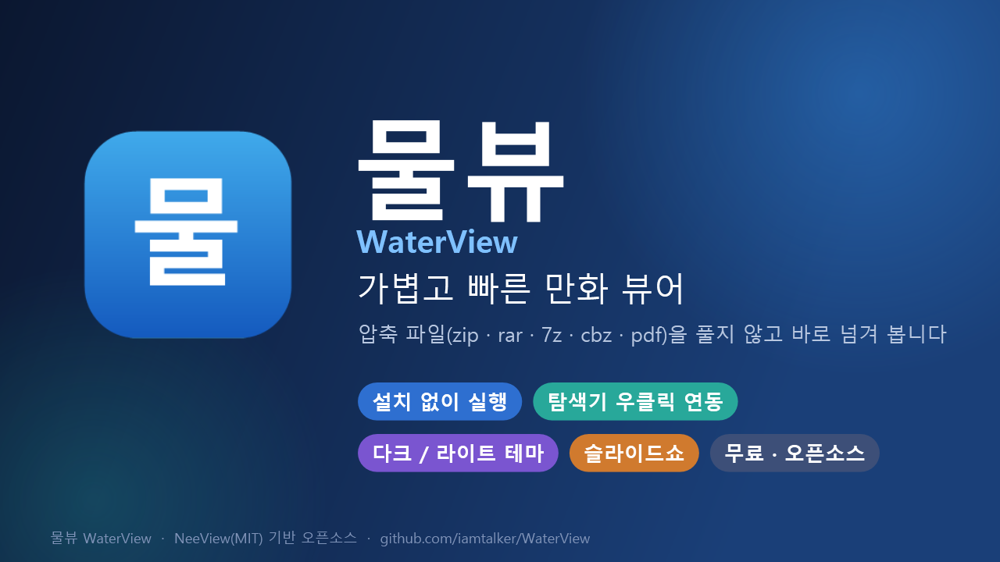
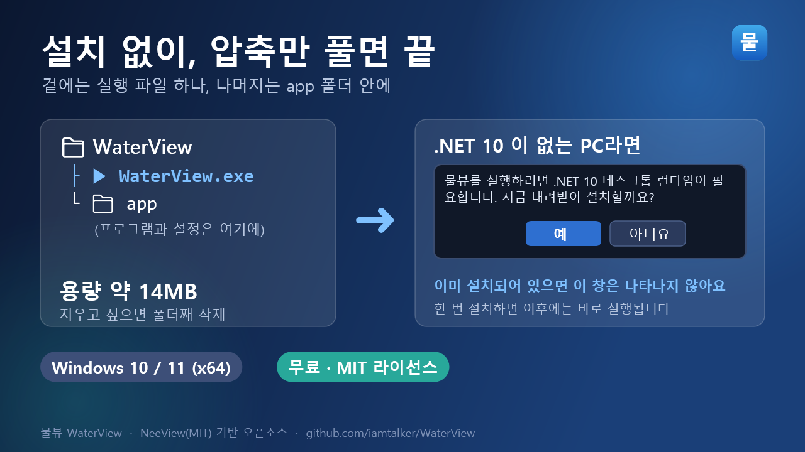
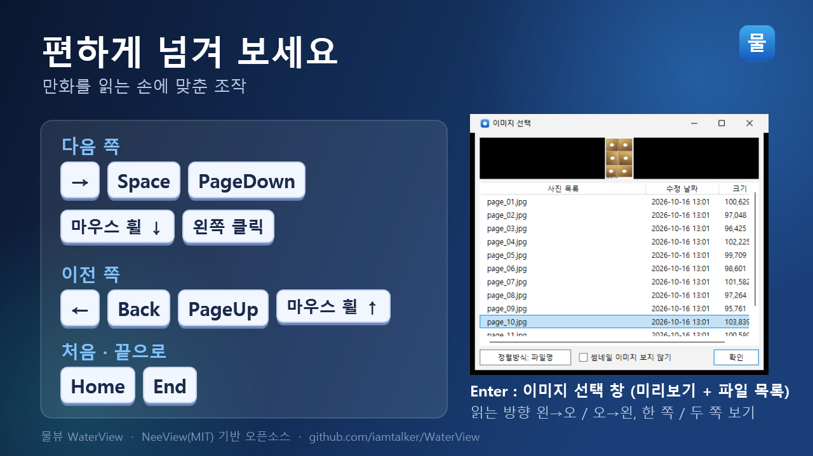
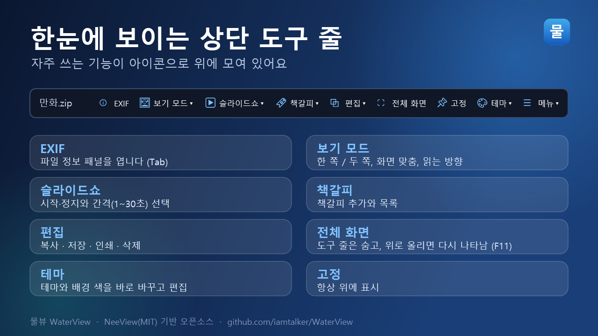
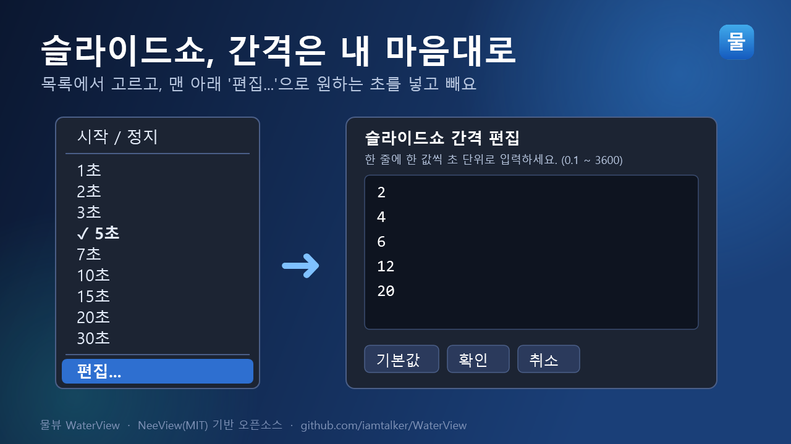
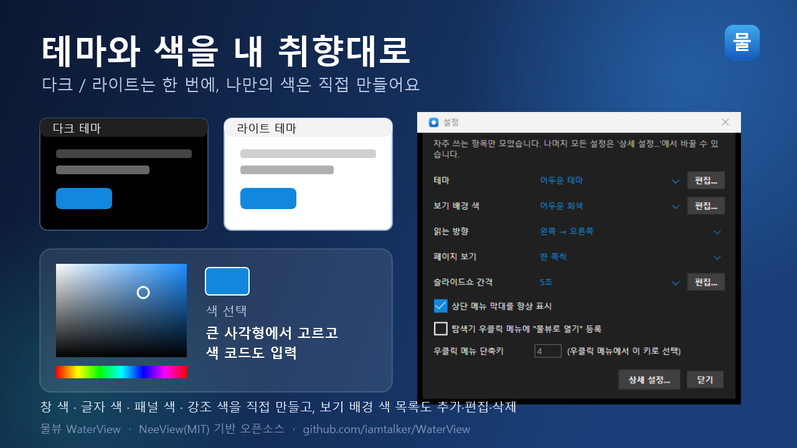
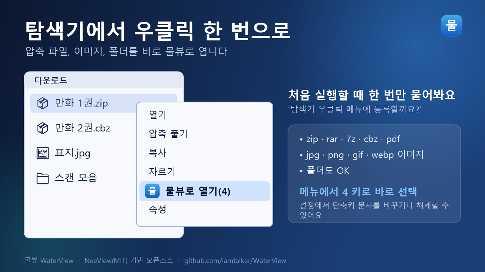

# 물뷰 (WaterView) — 가볍고 빠른 만화 뷰어

압축 파일(zip · rar · 7z · cbz · pdf)을 풀지 않고 바로 넘겨 볼 수 있는 Windows용 만화 뷰어입니다.
오픈소스 이미지 뷰어 [NeeView](https://github.com/neelabo/NeeView)(MIT)를 바탕으로, 만화를 볼 때 자주 쓰는 조작과 화면 구성을 단순하게 다듬었습니다. 무료이고 소스도 공개되어 있습니다.

**받기** : https://github.com/iamtalker/WaterView/releases/latest

---

## 이런 점이 좋아요

**1. 설치 없이 압축만 풀면 실행**

zip을 풀면 겉에는 `WaterView.exe` 하나만 보이고, 나머지는 `app` 폴더 안에 들어 있습니다. 지우고 싶으면 폴더째 삭제하면 끝입니다. (약 14MB)
.NET 10 런타임이 없는 PC에서는 처음 실행할 때 "설치할까요?"라고 물어보고 자동으로 설치해 줍니다. 이미 있으면 아무 창도 뜨지 않습니다.

**2. 편하게 넘기는 조작**

다음 쪽은 `→` `Space` `PageDown` 마우스 휠 아래 / 왼쪽 클릭, 이전 쪽은 `←` `Back` `PageUp` 휠 위. 읽는 방향(왼→오 / 오→왼)과 한 쪽 / 두 쪽 보기를 고를 수 있습니다.
`Enter` 를 누르면 미리보기가 있는 "이미지 선택" 창에서 원하는 쪽으로 바로 이동합니다.

**3. 한눈에 보이는 상단 도구 줄**

EXIF · 보기 모드 · 슬라이드쇼 · 책갈피 · 편집 · 전체 화면 · 고정 · 테마 · 메뉴가 아이콘으로 위에 모여 있습니다. 전체 화면(F11)에서는 도구 줄이 숨고, 마우스를 위로 올리면 다시 나타납니다.

**4. 슬라이드쇼 간격을 마음대로**

목록에서 1~30초를 고르고, 맨 아래 `편집...` 에서 원하는 초를 넣거나 뺄 수 있습니다.

**5. 테마와 색을 내 취향대로**

다크 · 라이트 · 흑백 · 고대비 테마를 바로 바꿀 수 있고, 창 색 · 글자 색 · 패널 색 · 강조 색을 직접 만들어 저장할 수 있습니다. 보기 배경 색 목록도 추가 · 편집 · 삭제됩니다. 색은 큰 사각형에서 고르거나 색 코드로 입력합니다.

**6. 탐색기 우클릭으로 바로 열기**

처음 실행할 때 한 번 물어보고, 허락하면 압축 파일 · 이미지 · 폴더를 우클릭했을 때 `물뷰로 열기(4)` 가 나타납니다. 메뉴에서 `4` 키로 바로 선택할 수 있고, 설정에서 키 문자를 바꾸거나 해제할 수 있습니다.

**7. 간단한 설정 창**
`F5` 는 자주 쓰는 항목(테마, 배경 색, 읽는 방향, 슬라이드쇼 간격, 우클릭 메뉴)만 모은 간단한 창입니다. 나머지 모든 설정은 `상세 설정...` 에서 바꿉니다.

---

## 알아두세요

- Windows 10 / 11 (x64) 전용입니다.
- 서명되지 않은 프로그램이라 처음 실행할 때 Windows SmartScreen 경고가 나올 수 있습니다. ("추가 정보 → 실행")
- 아직 초기 버전이라 부족한 부분이 있을 수 있습니다. 불편한 점이나 아쉬운 기능은 [Issues](https://github.com/iamtalker/WaterView/issues) 로 알려 주세요.
- NeeView(제작: Ito Mitsuhiro, MIT 라이선스)를 기반으로 만든 포크이며, 원본의 저작권 표시와 라이선스를 그대로 유지합니다. 다른 상용 뷰어의 코드나 이미지는 사용하지 않았습니다.

**소스 / 문의** : https://github.com/iamtalker/WaterView

---

### 짧은 소개 (게시판 한 줄용)

> 설치 없이 압축만 풀어 쓰는 가벼운 만화 뷰어 '물뷰'를 공개합니다. zip/cbz/rar/7z/pdf를 풀지 않고 바로 넘겨 보고, 탐색기 우클릭으로 열 수 있고, 테마와 색을 직접 편집할 수 있어요. 무료·오픈소스(MIT)입니다. https://github.com/iamtalker/WaterView
